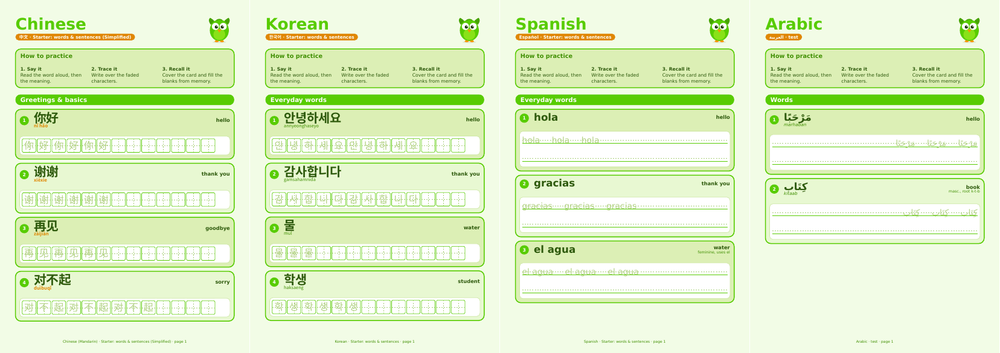

# duolingo-skills

Duolingo-style language practice sheets (PDF or Typst), one shared toolkit for **humans and AI agents**. Each word or sentence sits on a green rounded card with its reading and meaning, then a **faded trace row** and **blank space** to rewrite it from memory. Strongest for Japanese and Chinese writing practice.

Independent study tool; not affiliated with or endorsed by Duolingo.



| You are | Start here |
|---|---|
| A human | Quick start below, then `references/languages/<code>.md` for your language |
| An agent (Claude, Codex, Cursor, ...) | `AGENTS.md` → `SKILL.md` |

Covers 47 real-language guides for languages offered or recently offered by Duolingo. Fictional languages (Klingon, High Valyrian) are excluded.

## Quick start

```bash
pip install typst            # bundles the Typst compiler
python scripts/build.py assets/vocab/ja.json -o japanese.pdf
python scripts/build.py assets/vocab/zh.json -o chinese.pdf --cell 1.3 --rows 2
python scripts/build.py assets/vocab/ko.json --project-dir ./ko-typst   # keep editable .typ
```

Options: `--cell CM` (default 1.15), `--rows N` (1), `--copies N` (3), `--no-intro`, repeatable `--font-path DIR`, `--project-dir DIR` (keep editable Typst files), and `--fallback` (force ReportLab; see [fallback limits](references/pdf-fallback.md)).

## Layout

```
AGENTS.md / SKILL.md        entry points for agents (workflow + rules)
scripts/
  build.py                  vocab JSON -> PDF (Typst, CLI, or fallback)
  build_pdf_fallback.py     reportlab fallback (LTR + CJK only)
assets/
  template.typ              reusable Typst design
  mascot.svg                original stand-in mascot (replace freely)
  languages.json            registry: fonts, direction, grid mode
  vocab/                    starter vocab: ja, zh, ko, es
references/
  design-guide.md           palette, typography, card anatomy
  vocab-schema.md           JSON format and limits
  typst-guide.md            fonts, RTL, template internals
  pdf-fallback.md           fallback limits
  languages-index.md        all languages, codes, status
  languages/<code>.md       per-language guides
evals/evals.json            test prompts
```

## Vocab format

```json
{
  "lang": "ja",
  "title": "Japanese",
  "sections": [
    {"title": "Everyday words", "type": "words",
     "items": [{"text": "学生", "reading": "がくせい", "roman": "gakusei", "meaning": "student"}]},
    {"title": "Sentences", "type": "sentences",
     "items": [{"text": "水を飲みます。", "reading": "みずをのみます。", "roman": "mizu o nomimasu", "meaning": "I drink water."}]}
  ]
}
```

Full schema: `references/vocab-schema.md`.

## How practice cards work

- **CJK / Hangul**: one character per square cell with a dashed cross (tian zi ge). Words: faded copies, then blanks. Sentences: a faded row with a blank row directly under it.
- **Other scripts**: ruled lines with baseline and x-height guides. Arabic, Hebrew and Yiddish run right-to-left. Connected scripts (Arabic, Devanagari, Thai...) are never split into cells.

## Fonts

Install Noto Sans CJK (JP/SC/TC/KR/HK), plus Noto Naskh Arabic, Noto Sans Hebrew, Devanagari, Thai, etc. for those languages. Quicksand or Nunito give the rounded look; DejaVu Sans is the fallback. Details in `references/typst-guide.md`.

## Notes

- Always check page 1 of the output; missing glyphs render as empty boxes.
- Languages marked *verify* in the index (Cantonese, Yiddish, Bengali, Tamil, Telugu, Punjabi, Tagalog, Xhosa, Guarani) need a check against duolingo.com/courses.
- The look is inspired by Duolingo's style; it does not use Duolingo's mascot, logo or name.
- Stroke-order data, if you add it, should come from open datasets (KanjiVG, Make Me a Hanzi) with credit.
